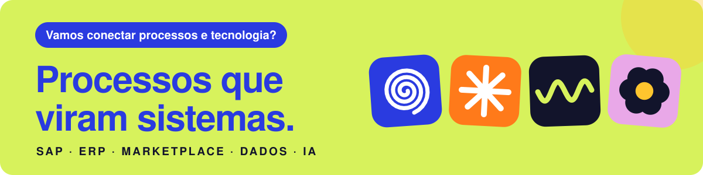

## Hi, I'm Adélia Modesto

Data and Process Analyst with 14 years of experience in operations, procurement, ERP and e-commerce. I turn operational data into decisions: margin by channel, ABC curve, ROAS, conversion and customer service indicators. I connect what the operation needs to what the system delivers.

<table align="center">
<tr>
<td align="center"><h2>14</h2>anos em operações, compras, ERP e e-commerce</td>
<td align="center"><h2>9+</h2>anos de SAP (MM e PM)</td>
<td align="center"><h2>6</h2>marketplaces integrados ao ERP</td>
<td align="center"><h2>1.200</h2>SKUs no ERP</td>
<td align="center"><h2>600</h2>pedidos por mês (média)</td>
</tr>
</table>

### Onde eu atuo

| Sistemas e ERP | Marketplace e e-commerce | Dados e IA |
| --- | --- | --- |
| Usei o **SAP (MM e PM)** de 2011 a 2020, do ECC ao S/4HANA, com testes na migração e operação no SAP Fiori. | Implantei do zero o **ERP Bling** e a integração com **6 marketplaces** em um varejo 100% físico. | Margem por canal, curva ABC, ROAS e conversão, com **IA e automações** no dia a dia: Claude, ChatGPT, Gemini, Copilot, NotebookLM e n8n. |

### Ferramentas

**Sistemas e ERP**
 

**E-commerce e atendimento**
 

**Dados**
 

**Automação e IA**
 

### Projetos

| Projeto | O que é | Status |
| --- | --- | --- |
| [Dashboard de performance de marketplace](https://github.com/adeliamodesto/dashboard-marketplace) | Power BI e SQL com dados fictícios: receita, margem por canal, ROAS, conversão e curva ABC. | Em construção |
| Agente de IA no WhatsApp | Atendimento automatizado com n8n, WhatsApp Business e Power BI, em cenário fictício. | Próximo |
| Compras e estoque no SAP S/4HANA | Análise de compras e estoque com dados fictícios. | Próximo |

### Em estudo agora

Curso **Sistemas de Informação na FIAP**. Estudando **SAP S/4HANA** (MM, SD e PP), **Power BI** (preparação para a certificação PL-300), **SQL** e **Python**.

### Vamos conversar

